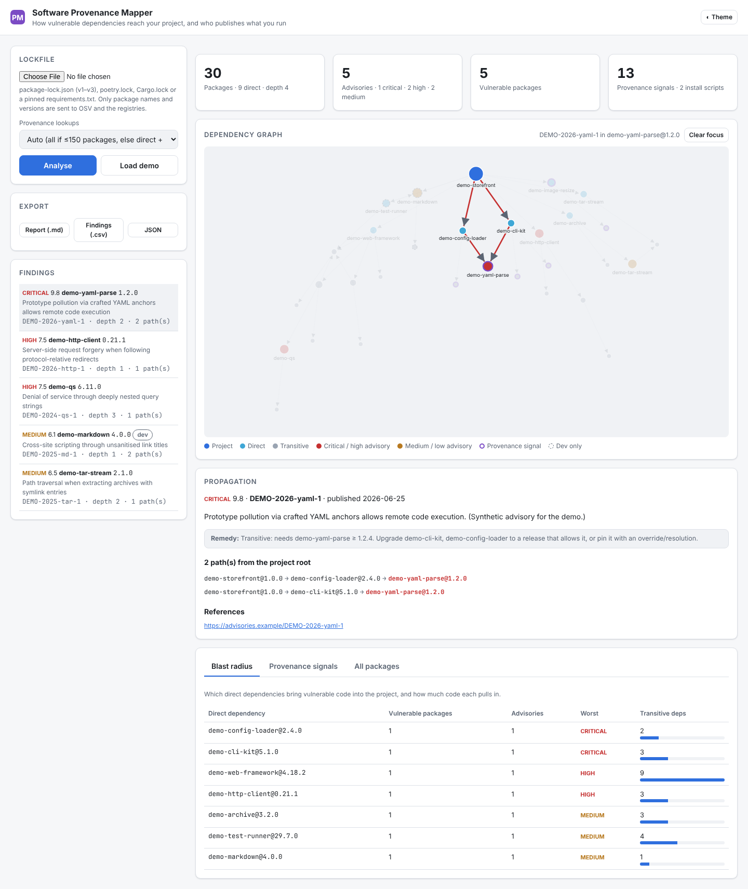

# Open-Source Software Provenance Mapper

**Trace how a vulnerable dependency reaches your project, which direct dependency brought it in, and what to change. The mapper also shows who publishes the code you run.**



## What it does

1. **Parses lockfiles** into a dependency graph:
   * `package-lock.json` / `npm-shrinkwrap.json`, lockfile v1, v2 and v3. Nested `node_modules` paths are resolved the way Node resolves them, so when two copies of a package coexist the tool attributes the right one.
   * `poetry.lock` and `Cargo.lock`
   * pinned `requirements.txt` (flat). Unpinned lines are reported rather than silently dropped.
2. **Queries [OSV.dev](https://osv.dev)** in batches for every `name@version`, fetches each advisory, computes **CVSS v3.x base scores** from vectors (the calculator follows the FIRST spec) and extracts the *fixed* version for that package.
3. **Traces propagation.** It finds every path from the project root to each vulnerable package, shortest first, without looping on cycles and capped for huge graphs. It reports the depth and the direct dependency responsible.
4. **Recommends remediation.** For a direct dependency: "Upgrade X to ≥ Y". For a transitive one: which parent needs a release that allows the fix, or an override.
5. **Collects provenance** from the npm / PyPI / crates.io registry and the GitHub API:
   | Signal | Why it matters |
   |---|---|
   | Install script | Code runs automatically at install time |
   | Very recent release (≤ 14 days) | Most malicious releases are caught within days |
   | Single maintainer | One compromised account can publish to every dependent |
   | No release in 2+ years / archived repo | Fixes may never ship |
   | No source repository | The artefact can't be traced to public source code |
   | Deprecated / yanked | The maintainer has disowned this version |

   Signals are **prompts for review, not defects**, and the UI and reports say so.
6. **Blast radius**: for each direct dependency, how many vulnerable packages and advisories it pulls in, its worst severity and the size of its transitive tree.

## Quick start

```bash
git clone https://github.com/Sentinel1569/osint-provenance-mapper.git && cd osint-provenance-mapper
python -m venv .venv && source .venv/bin/activate
pip install -e ".[dev]"
python -m provmap serve          # http://127.0.0.1:8000, then "Load demo"
```

### CLI (CI-friendly)

```bash
python -m provmap demo
python -m provmap scan path/to/package-lock.json
python -m provmap scan poetry.lock --markdown > deps-report.md
python -m provmap scan Cargo.lock --csv > findings.csv
python -m provmap scan package-lock.json --provenance none --fail-on high   # exit 1 on high/critical
```

`GITHUB_TOKEN` (optional) raises the GitHub API rate limit for repository lookups.

### Privacy

Only package **names and versions** leave your machine (to OSV and the registries). The lockfile itself is never uploaded anywhere.

## Demo project

`provmap/demo.py` builds a fictional npm project (`demo-storefront`, 30 packages) together with OSV, registry and GitHub responses. Every package name starts with `demo-` and every advisory ID with `DEMO-`. The demo includes:

* a critical advisory reachable through **two** direct dependencies
* two coexisting versions of `demo-tar-stream`, of which only the nested copy is vulnerable
* a dev-only XSS advisory
* a freshly published, single-maintainer package with an install script and no repository link, plus an archived package and a deprecated one

## Project layout

```
provmap/lockfiles.py   npm v1–v3 / poetry / cargo / requirements parsers → graph
provmap/sources.py     OSV, npm / PyPI / crates.io registries, GitHub API (+ pure parsers)
provmap/cvss.py        CVSS v3.0/3.1 base-score calculator
provmap/mapper.py      paths, depths, remediation, provenance signals, blast radius
provmap/report.py      Markdown + CSV
provmap/static/        D3 force graph with path highlighting
```

## Tests

```bash
make test && make lint
```

## License

MIT. Bundles D3 (ISC).
